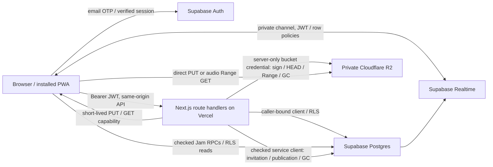

# Adhure Kisse architecture and decision record

Reviewed: **2026-10-03**. Scope: **`sites/adhurekisse`**. Companion documents: [operations](ADHUREKISSE-OPERATIONS.md), [security](ADHUREKISSE-SECURITY.md), [Android acceptance](ANDROID-TEST-MATRIX.md).

This is a design/integration record. Implemented SQL/server/UI/Jam/player changes are distinguished from hosted provider and physical-device acceptance. No Supabase project, R2 bucket, email provider, Vercel deployment, or scheduler was configured by this repository work.

## Evidence and initial audit

Read the root README and `docs/{DEPLOYMENT,ADMIN-GUIDE,LIMITATIONS}.md`, the site's Vercel/new-site/public-media instructions, migrations 0001–0003, active package/lockfile, Auth/storage helpers, player/service worker, and all three agent audit/results documents:

- [`server-audit.md`](../sites/adhurekisse/docs/server-audit.md): SQL, RLS, API, upload verification, playlists, invitation delivery, limits, GC and isolated server/database results.
- [`ui-audit.md`](../sites/adhurekisse/docs/ui-audit.md): admin/login/library interactions, accessibility, request contracts and isolated frontend results.
- [`jam-audit.md`](../sites/adhurekisse/docs/jam-audit.md): synchronization, transport ownership, lifecycle, readiness/chat and unit results.

These files are the available agent handoffs/results. No separate consolidated agent-results file was present at review. Their reported passes are evidence for their stated scope, not a new whole-site pass. The server handoff and current 0003 SQL include atomic `set_track {queue_item_id}` consumption; the Jam handoff's earlier “remaining DB extension” paragraph is superseded by that SQL.

The initial system had real private-library/Jam scaffolding but unsafe or incomplete boundaries:

| Initial finding | Consequence | Current decision |
|---|---|---|
| First Auth user became admin; Auth account/profile alone enabled access | Bootstrap race and legacy-account trust | 0003 creates inactive, non-admin profiles; operator verifies and activates one owner **by Auth UUID** |
| Broad profile/open-room reads, Jam-derived track permission, outsider leave | Metadata disclosure and unintended playback/control | Active invitation gate, scoped RLS/ACLs, member-only rooms, independent playback rights for both listeners |
| Reusable writable object keys; HEAD-only finalize; artwork published early | Overwrite/content-spoofing and stale replacement | Random immutable intent keys, conditional PUT, size/MD5/HEAD + bounded conditional Range/magic checks before publication |
| Command IDs logged but not deduplicated; direct queue writes; spoofable readiness/chat | Double actions, stale timelines, false identity | Serialized revision-checked RPCs, identity-bound readiness/messages and durable command receipts |
| Client accepted stale revisions and raced loads; schedule/reconnect handling incomplete | Wrong track/position and duplicate lifecycle work | Coalesced monotonic state application, bounded scheduling/recovery, explicit host/guest authority |
| Upload UI raced metadata/duration/cancellation; login and dialogs lacked recovery/accessibility | Failed uploads and inaccessible/error-prone flows | Owned UI improvements and contract tests; persistent player/Next integration remains a main-owned acceptance item |

## Decision timeline: proposed → now

All entries below are from **2026-10-03**, in review/implementation order; they are not historical production release dates.

1. **Audit:** preserve the curated archive and existing app; complete private media and two-person Jam within this site. Preserve user edits and historical migrations.
2. **Proposed hardening:** move trust to provider-verified Auth, active profiles, database policies and checked RPCs; private R2 capabilities supply bytes without a Vercel audio proxy.
3. **Now in server/SQL:** forward migration `0003_private_library_hardening.sql`, no automatic admin, explicit grants/revocations, normalized shared playlists, durable limiting/GC, authenticated chat and private-channel policies. Apply after 0001 and 0002; legacy profiles become inactive.
4. **Now in UI/Jam:** corrected upload/retry/login/playlist workflows; readiness and chat use SQL RPCs, queue/control use command IDs/revisions, future starts wait for their anchor, reconnect reads authority again. Agent-isolated checks are recorded in their handoffs.
5. **Now in player/main integration:** layout-owned persistent playback context; manager transport override including Media Session/provider-ended; silent cue with playable-buffer readiness, stale-load cancellation, honest autoplay errors, refresh/recovery without duplicate elements. Local browser acceptance verifies private audio survives App Router navigation, Jam transport ownership, authorization failures and responsive layouts.
6. **Now in infrastructure/QA:** site-scoped runbooks, explicit-origin R2 CORS, test-only fixture/hosted acceptance procedure, Linux CI and repository secret scan. The local Next harness and generated-WAV tests run through `test:e2e:local`; the local suite passes its 27 substantive browser tests, with three optional axe audit cases skipped unless `QA_AXE_SOURCE` is supplied.
7. **Pending hosted/device acceptance:** migration on a disposable Supabase stack, real OTP/SMTP/R2/CORS/Realtime checks and all physical Android matrix rows. Local compilation or mocked browser tests do not satisfy these.

## Components and trust boundaries

- **Next.js App Router** serves the shell, `/login`, `/library`, `/admin`, REST metadata/auth checks and storage capabilities. Public archive/provider behavior is separate from private access: missing Supabase configuration does not authorize private APIs.
- **Supabase Auth** proves identity. `getUser(token)` verifies server callers; profile activation binds a confirmed `auth.users.email` to an unexpired, non-revoked invitation issued by an active admin. Invitation codes are administrative references, not email-proof substitutes.
- **Postgres** is the metadata and control authority. R2 listings, client identities, Presence and room codes are not authorities. All write paths recheck active profile, role/membership and relevant track rights.
- **Service-role client** bypasses RLS and stays server-only. Its use is limited to checked Auth invitations, library publication and GC; ordinary reads retain caller-bound RLS.
- **R2** remains private, including artwork. Presigns use the S3 API host, not an R2 public/custom-domain URL. The browser receives a bearer capability, never storage credentials or the app bearer token as an R2 header.
- **Player boundary** owns one persistent manager/audio lifetime above route changes. `next/link` navigation and explicit library play actions preserve it in the local browser acceptance harness. A service worker cannot own an HTML audio player or keep Jam JavaScript awake.

## Data and media lifecycle

| Domain | Authoritative records / rules |
|---|---|
| Identity | `profiles.is_active`, `is_admin`, `invitation_id`; confirmed Auth email; invitation issuer/expiry/revocation/acceptance |
| Library | `tracks`, `track_permissions`, `track_revocations`; explicit deny wins over ordinary owner/explicit/playlist-derived access; active admin retains administrative access |
| Playlists | `playlists.revision`, ordered `playlist_tracks`, `playlist_permissions`; owner edits; only admin owner can share with `grantTracks:true`; a link grants nothing |
| Uploads | Server-only `upload_intents`; pending → verified ready; live artwork unchanged until successful conditional replacement |
| Jam | `jam_rooms`, participants/readiness, revisioned `jam_room_state`, queue/events and durable `jam_messages`; one host + at most one guest, 12-hour default room expiry |
| Operations | Private limiter counters, command receipts and delayed `storage_gc`; callers cannot reset counters or acknowledge GC |

Upload flow: admin reserves intent → browser PUTs exact returned headers → server verifies expiry, nonzero size, allowlisted MIME, single-PUT MD5 ETag and at most 4 KiB of magic bytes via `Range` + `If-Match` → transaction publishes metadata. Limits: **200 MiB audio, 10 MiB artwork, 15-minute PUT**. Ready audio is immutable; retries reserve new keys. MD5/size deduplicates ready checksummed content, not authorship or malware. Header screening does not decode/transcode or verify codec/duration. Legacy unchecked media is not automatically reverified.

Playback flow: active caller asks `/api/tracks/:id/stream` → RLS confirms a ready authorized track → **five-minute GET** → HTML audio streams/seeks directly from R2. Artwork capabilities also last five minutes. Refresh must reacquire authorization; buffered bytes and previously issued URLs can outlive a grant revocation. Track deletion removes metadata/access immediately and queues object deletion after outstanding capability windows; cleanup must actually be invoked.

## Jam authority and synchronization

- Shared track/queue admission requires both current listeners' independent rights. Joining never grants a track. Unknown/full/invalid/rate-limited joins return **NULL** so the join-attempt counter commits; the UI reports generic unavailability.
- `jam_apply_command` requires command UUID and expected revision. Same actor/type/payload/ID returns the original result before stale-revision rejection; changed content is `COMMAND_ID_REUSED`. Successful commands advance revision, including queue/mode/end.
- Host controls queue add/remove/reorder, scheduling, collaborative mode, room end and automatic next. Guest may suggest; collaborative guest may use playback/atomic next/select-consume. Direct queue writes are denied.
- `jam_set_ready` binds authenticated user, track and observed revision; heartbeat alone is not readiness. Server requires fresh readiness for play/start. Start lead must be **200–5000 ms** ahead; the client uses roughly **1.2–3 seconds** based on RTT, with a bounded readiness wait and no forced bypass.
- For playing state, target position is `reference + max(0, estimatedServerNow - anchor)/1000`; paused/future-anchor state holds reference. Min-RTT monotonic clock estimates reduce noise, but do not measure audio-output latency.
- Drift defaults: ignore below 80 ms, nudge through 250 ms, seek above; RTT widens thresholds, nudges are bounded to ±3%/10 seconds, hard-seek cooldown is eight seconds. These are tuning parameters, not sample-accurate guarantees.
- Receive-only private topic `jam:<UUID>` uses JWT/private-channel policy plus table RLS. Chat/reactions and participant heartbeat come from identity-bound RPCs. No client Broadcast/Presence or public fallback.
- Published Jam authority signals: rooms/state/participants/messages/events. **Raw `tracks` and `jam_queue` are removed** because Postgres DELETE delivery cannot enforce membership RLS. Queue changes trigger an authoritative refetch via revision/events; REST owns library refresh.
- Reconnect/subscribe/resume performs authoritative reads, including a read after subscription. Visibility/freeze recovery is best-effort; hidden/frozen pages cannot execute sync/auto-next. Host network loss does not elect a guest or automatically end the room. Leave/end releases shared transport ownership; buffered audio can continue locally.

## Deployment identity and integration state

The only user-provided deployment URL is **`https://only-for-you-olive.vercel.app`**. A public, read-only fetch on 2026-10-03 returned **OnlyForYou** branding and a 68-song archive. This indicates a deployment identity mismatch; it does not reveal Vercel settings or prove the selected root. Verify the existing project's **Root Directory is `sites/adhurekisse`, not `sites/onlyforyou`**, its source revision, environment scope and alias before using it as this app's deployment. Existing hardcoded metadata origins are also main-owned corrections to verify. No replacement deployment URL is assumed.

Dependency snapshot: declared and installed Next **15.5.27**, React/React DOM **19.2.8**, Vitest **5.0.4** and Vite **7.3.7**. `npm audit --audit-level=high` remains non-zero with 11 findings (8 high, 3 moderate): Tailwind 3's legacy `braces` chain, Next 15's nested PostCSS 8.4.31, and Next ESLint/Tailwind parser dependencies. The available automatic fixes require major migrations to Next 16 and Tailwind 4; those were not applied without a separate compatibility review. ESLint is explicitly installed/configured and runs without errors; two remote-artwork `` performance warnings remain.

## Official references

Consulted 2026-10-03. Provider settings/quotas can change; [operations](ADHUREKISSE-OPERATIONS.md) records their practical implications.

- Next 15: [environment loading/public build-time values](https://nextjs.org/docs/15/app/guides/environment-variables), [production build and security guidance](https://nextjs.org/docs/15/app/guides/production-checklist).
- Vercel: [monorepo root-directory selection](https://vercel.com/docs/monorepos).
- Cloudflare R2: [presigns and custom-domain restriction](https://developers.cloudflare.com/r2/api/s3/presigned-urls/), [explicit CORS and expired-URL behavior](https://developers.cloudflare.com/r2/buckets/cors/), [pricing](https://developers.cloudflare.com/r2/pricing/).
- Supabase: [email OTP](https://supabase.com/docs/guides/auth/auth-email-passwordless), [SMTP](https://supabase.com/docs/guides/auth/auth-smtp), [RLS/ACLs](https://supabase.com/docs/guides/database/postgres/row-level-security), [Realtime authorization/cache](https://supabase.com/docs/guides/realtime/authorization), [Postgres Changes](https://supabase.com/docs/guides/realtime/postgres-changes), [Realtime limits](https://supabase.com/docs/guides/realtime/limits), [Free plan](https://supabase.com/pricing).
- Android: [Media3 background playback](https://developer.android.com/media/media3/session/background-playback), [official MediaSessionService lifecycle documentation/source](https://github.com/androidx/media/blob/release/libraries/session/src/main/java/androidx/media3/session/MediaSessionService.java). Media3 is a possible future native architecture, not part of this web app.
